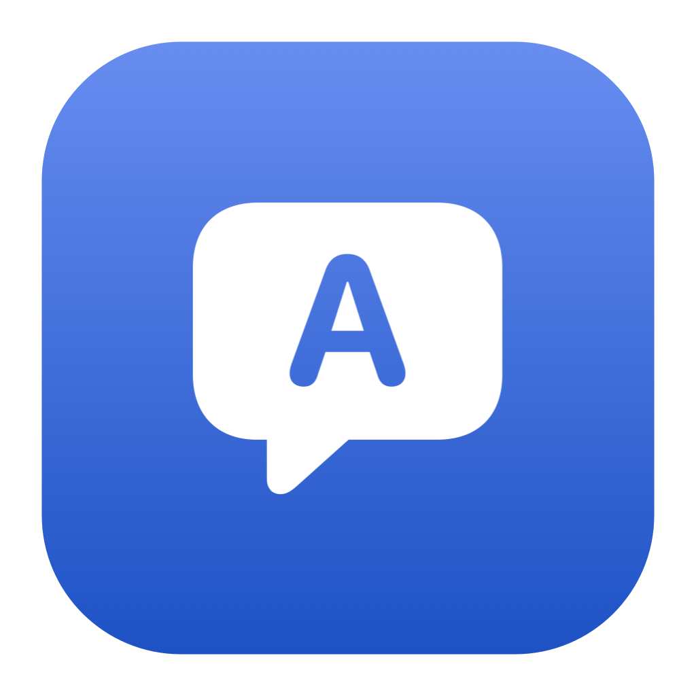
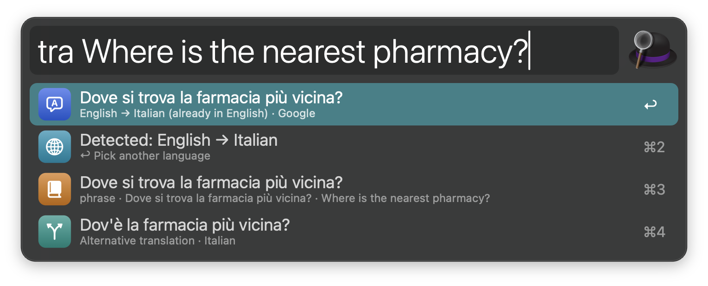
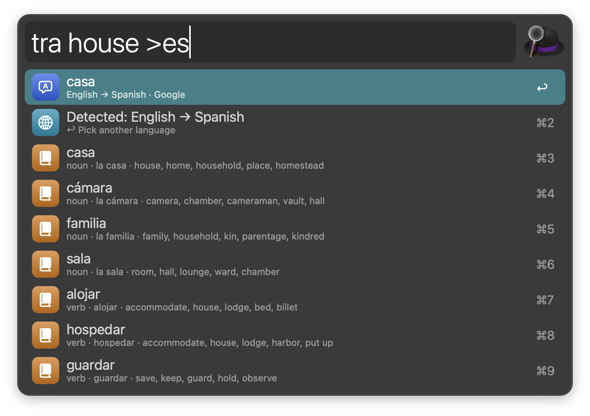
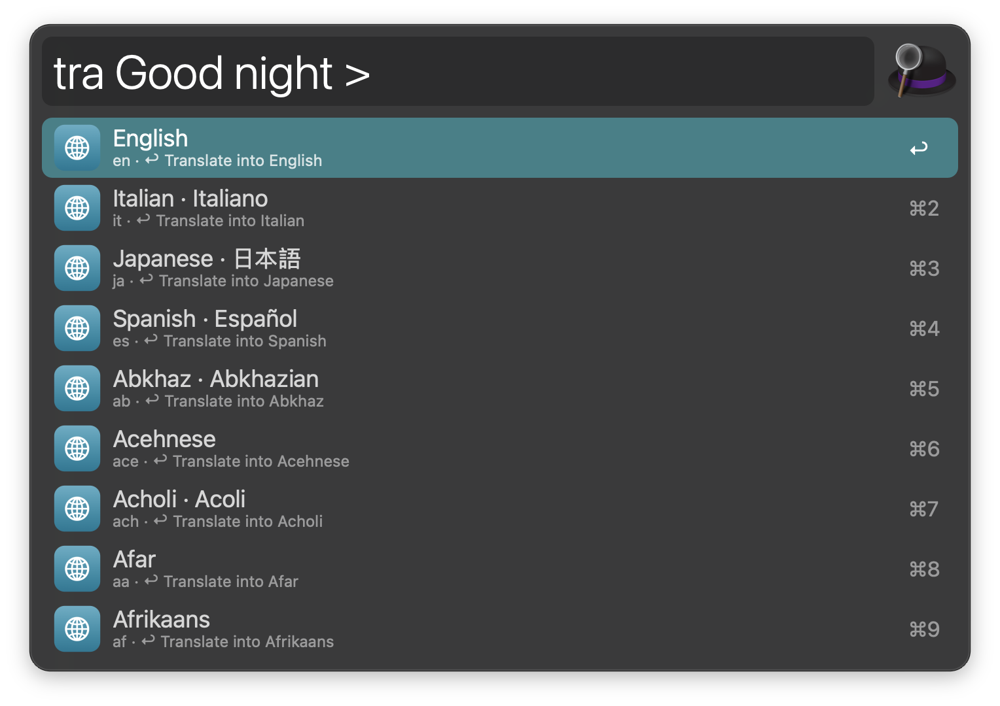
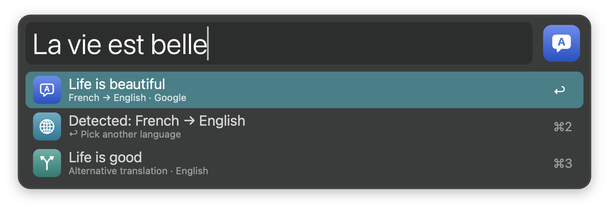
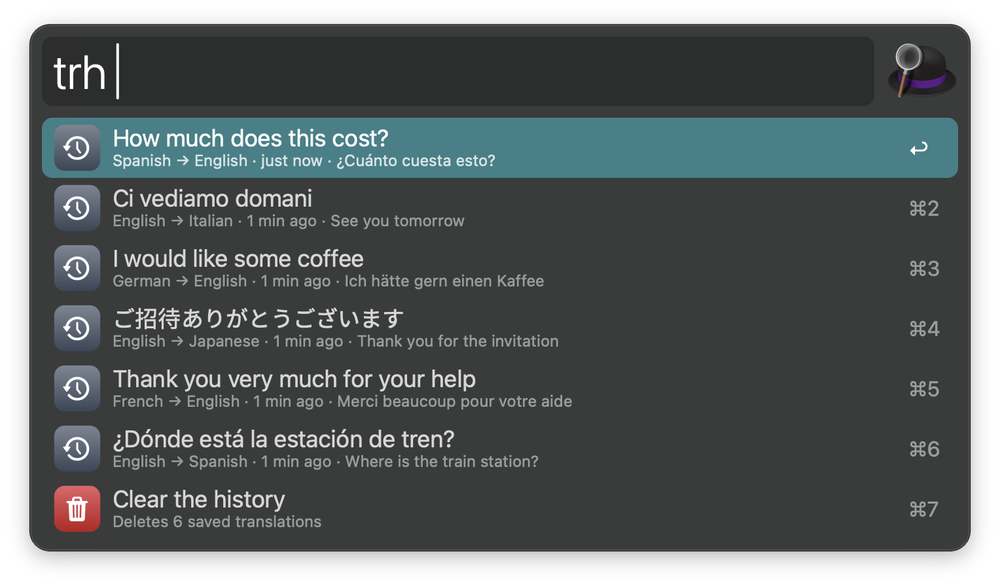
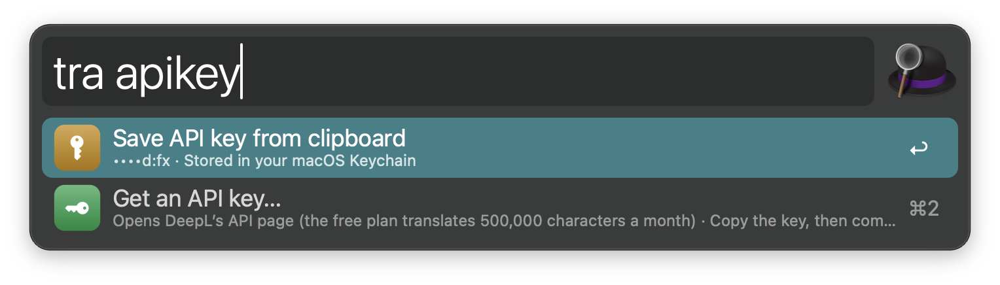

#  Translate

Translate text in Alfred with Google Translate or DeepL: several languages at once, dictionary meanings, romanization, speech and a history. No dependencies: everything runs on tools that ship with macOS.

## Usage

Translate text via the `tra` keyword. The language is detected, and the text is translated into your language. When the text is already in your language, it is translated into your second language instead, so one keyword works both ways (English text becomes German, German text becomes English). With nothing typed, Translate uses the text in the clipboard.



* <kbd>↩</kbd> Copy the translation.
* <kbd>⌘</kbd><kbd>↩</kbd> Paste the translation into the frontmost app (it replaces the selected text).
* <kbd>⌥</kbd><kbd>↩</kbd> Open in Google Translate or DeepL.
* <kbd>⌃</kbd><kbd>↩</kbd> Speak the translation. Press it again to stop.
* <kbd>⇧</kbd><kbd>↩</kbd> Swap: translate the translation back.
* <kbd>⌘</kbd><kbd>C</kbd> Copy without closing Alfred.
* <kbd>⌘</kbd><kbd>L</kbd> Show in Large Type.
* <kbd>⌘</kbd><kbd>Y</kbd> Quick Look long text, with the original below the translation.

For a word or a short phrase, the rows below the translation show its meanings by part of speech, alternative translations, definitions, examples and synonyms. A translation into another script gets a romanization row (like *Kon’nichiwa* for こんにちは), the language row shows how text in another script is pronounced, and a spelling mistake gets a “Did you mean…” row.



Choose the language as you type: add `>fr` before or after the text for French, `>fr,ja` for French and Japanese, or `en>de` to set the source language too. Language names work as well, in English or in the language itself (`>german`, `>deutsch`). Type `>` on its own, or press <kbd>↩</kbd> on the language row, to search every language; recently used languages come first.



Alternatively, translate selected text via the Universal Action, or configure the Hotkey to translate the selection in one step.



To replace selected text with its translation without opening Alfred, configure the second Hotkey, or use the “Translate and Replace” Universal Action.

Search your recent translations via the `trh` keyword. They are saved when you copy, paste or speak a translation.



* <kbd>↩</kbd> Copy the translation.
* <kbd>⌘</kbd><kbd>↩</kbd> Paste it into the frontmost app.
* <kbd>⌥</kbd><kbd>↩</kbd> Translate the original again via the `tra` keyword.
* <kbd>⌃</kbd><kbd>↩</kbd> Speak it.
* <kbd>⇧</kbd><kbd>↩</kbd> Remove it from the history.

Type `tra :` for the settings rows: clear the history, clear cached translations, or open the Workflow’s Configuration.

### DeepL

To translate with DeepL, pick it in the Workflow’s Configuration and save an API key via `tra apikey`: copy the key and press <kbd>↩</kbd> on “Save API key from clipboard”, or type it after `apikey`. The key is stored in your macOS Keychain, and the clipboard is cleared once it’s saved. The same rows show how many characters you have used this month, and “Get an API key…” opens DeepL’s page for a free key (500,000 characters a month).



When DeepL can’t translate (no key, a used-up monthly limit, or a language it doesn’t have), Google Translate steps in and a row says so. Dictionary meanings, romanization and alternatives come from Google Translate only.

### Speech

Translations are read aloud by the macOS voice for their language, which works offline. For a language without an installed voice, Google Translate’s voice is used instead; add more voices in System Settings › Accessibility › Spoken Content, or choose between the two in the Workflow’s Configuration.

Configure your languages, extra languages to always translate into, the <kbd>↩</kbd> action (copy or paste), the dictionary rows, the clipboard, the history, speech, and DeepL’s formality and English variant in the Workflow’s Configuration. Every keyword can be changed there too.

## Development

```bash
swift tools/make_icons.swift tools/icons.json src   # regenerate icons
osascript -l JavaScript tools/make_languages.js tools/google_languages.json src/languages.json
python3 tools/build.py --package                     # write src/info.plist and dist/*.alfredworkflow
python3 -m unittest discover -s tests                # run the tests (a local mock stands in for Google and DeepL)
```

## AI disclosure

This workflow was developed with the help of Claude (Anthropic), an AI assistant. The code is reviewed and tested by the author.
